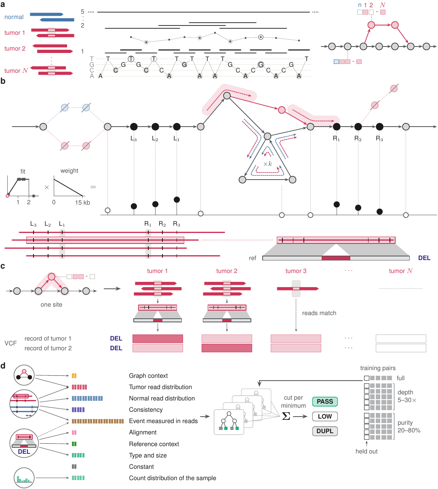
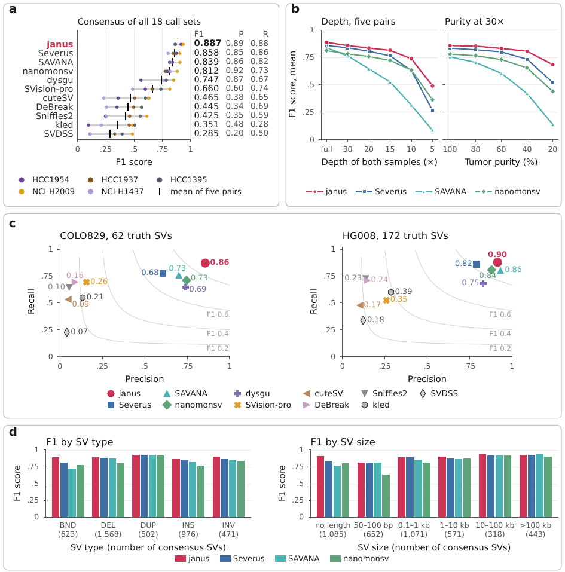
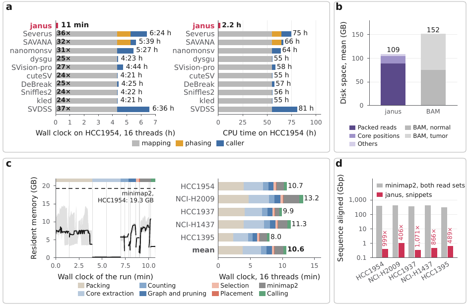

# janus

janus calls somatic structural variants (SVs) from PacBio HiFi reads of a tumor and its matched normal, or of several tumors of one patient at once. It builds a personal pangenome graph of LCP cores from all reads, finds the sites only tumor reads pass through, and aligns only short snippets around them.

<p align="center"></p>

## Installation

janus builds on Linux with g++ (C++17), gcc, git, nasm and zlib; `janus run` also needs minimap2 in `PATH`.

```
git clone https://github.com/Muti-Kara/janus.git
cd janus
make          # build/janus; lcptools and rapidgzip are fetched into lib/
make ref      # ref/: hg38 with the chrY PARs masked, CHM13v2, their indexes (janus refidx, minimap2)
```

## Quick start

List the samples of a patient in a sheet: one normal and one or more tumors, as FASTQ, FASTQ.gz or BAM.

```
name	role	path
n	normal	reads/normal.fastq.gz
t	tumor	reads/tumor.fastq.gz
```

```
build/janus run --samples sheet.tsv --ref ref/hg38_parmask --model models/janus.model --out out/ --threads 16
```

With one tumor the run is pairwise; with several it is joint, calling all tumors in one graph. A stopped run resumes from its last finished step.

## Output

| File | Content |
|---|---|
| `janus.vcf` | All candidate SVs. FILTER is `PASS`, `LOW` (below the classifier cut) or `DUPL` (duplicate of a stronger call); `VP` is the somatic probability; joint runs add `CARRIERS`, the other tumors that share the SV. |
| `calls.vcf` | The candidates before classification. |
| `steps.tsv` | Wall clock, CPU time and peak memory of every step. |

`models/janus.model` is trained on all five CASTLE pairs; `models/janus_without_<pair>.model` leaves one pair out.

## Commands

`janus run` chains the steps below; each can also be run alone (`build/janus` prints their options).

| Step | Does |
|---|---|
| `pack` | packs reads two bits per base |
| `extract` | LCP cores of every read |
| `count`, `graph`, `prune` | core counts per sample, the joint graph, the tumor-only sites |
| `select`, `place`, `lift`, `clip`, `patch` | read snippets around each site, aligned to the reference |
| `call` | SV records with their features |
| `classify`, `joint` | somatic probability and filter, for one tumor or several |

## Results

On five tumor/normal cell line pairs of the CASTLE panel, scored against the consensus of 18 call sets, janus has a mean F1 score of 0.887; the next best caller, Severus, has 0.858. The lead grows at low depth (0.489 against 0.362 at 5×) and low purity (0.683 against 0.520 at 20%). On COLO829 and HG008, which were not used for training, janus has the highest F1 score of all HiFi callers (0.864 and 0.896).

<p align="center"></p>

A pair takes about 11 minutes on 16 threads from FASTQ to calls, 24 times faster than mapping its reads with minimap2 alone.

<p align="center"></p>

On a simulated patient with 20 tumors at 5× and a 20× normal, one joint run raises the median F1 score from 0.712 (20 pairwise runs) to 0.839.

## Repository

| Path | Content |
|---|---|
| `src/` | janus (C++) |
| `models/` | the trained classifiers |
| `ref/build.sh` | the references |
| `datasets/` | sample sheets, download (`fetch.sh`) and simulation (`simulate.sh`) scripts |
| `bench/` | one script per experiment of the paper; `callsets/` holds every call set we scored |
| `paper/` | the manuscript, its figures and tables |

`make datasets`, `make simulation`, `make bench-setup`, `make bench-<step>` and `make figures` reproduce the paper; see the top of the `Makefile`.

## License

BSD 3-Clause; see `LICENSE`.
